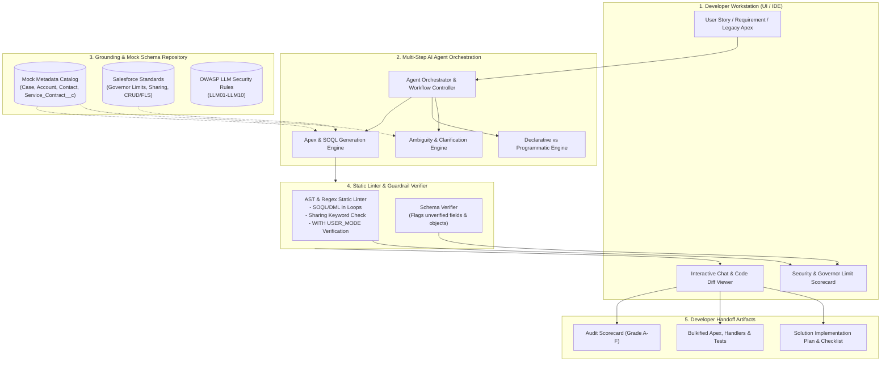
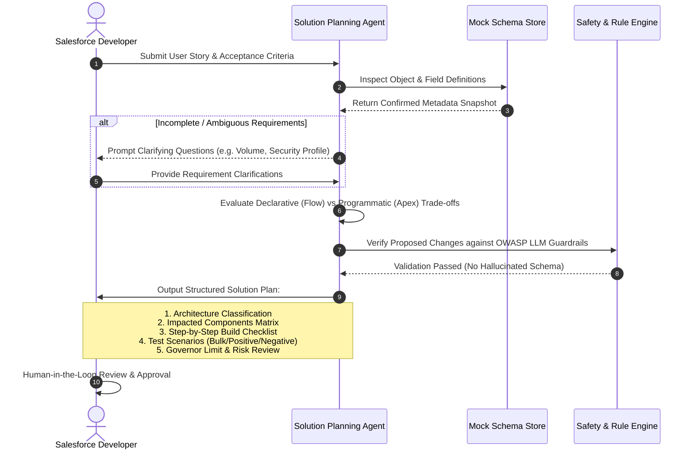
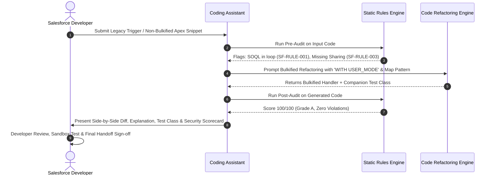

# Architecture & System Design: Salesforce AI Developer Studio

---

## 1. System Overview

The **Salesforce AI Developer Studio** is an AI enablement system composed of two specialized tracks:
1. **Salesforce Solution Planning Agent (Use Case 1)**: Analyzes requirements, checks metadata schemas, recommends declarative (Flow) vs programmatic (Apex) solutions, generates build checklists, test scenarios, and security/governor-limit risk reviews.
2. **Salesforce Apex, SOQL & Flow Coding Assistant (Use Case 2)**: Generates and refactors Apex classes, creates invocable actions for Flow, optimizes SOQL selectivity, produces robust unit tests ($\ge 85\%$ coverage), and performs real-time static security/governor-limit auditing.

---

## 2. End-to-End Architecture Diagram

---

## 3. Sequence Diagram: Solution Planning Workflow

---

## 4. Sequence Diagram: Code Refactoring & Security Audit Workflow

---

## 5. Security Guardrails & Human-in-the-Loop Governance

1. **Zero Production Mutation**: The agent operates purely as an advisory planning and code generation workbench. It does not possess direct deployment privileges to production Salesforce environments.
2. **Context Grounding & Hallucination Defense**: Every object and field reference is validated against the static `mock_schema.json` catalog before generation to prevent nonexistent API calls.
3. **Data Privacy**: Input prompts must be sanitized with zero customer PII, secrets, or org tokens.
4. **Mandatory Human Sign-off**: Every AI-generated design and code artifact is stamped with an AI-assistance notice requiring explicit review and sandbox unit testing by a certified Salesforce developer.
